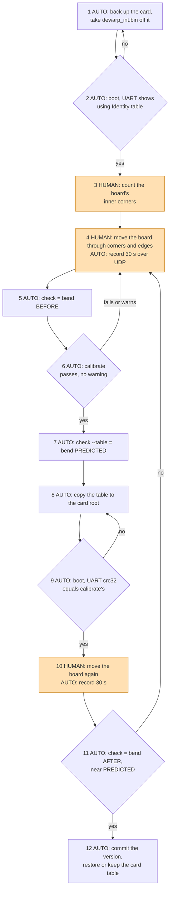

# Build
This build is for the C++ tools (`thermal_homography`, and the older `undistort_table`). The dewarp table needs no build, see [Dewarp table](#dewarp-table).

First, you have to build opencv 4.11.0 on your host. Follow the official instruction:
https://docs.opencv.org/4.x/d7/d9f/tutorial_linux_install.html

You can disable some unnecessary options for speedup:
```
# Download and unpack sources

wget -O opencv.zip https://github.com/opencv/opencv/archive/4.x.zip
wget -O opencv_contrib.zip https://github.com/opencv/opencv_contrib/archive/4.x.zip
unzip opencv.zip
unzip opencv_contrib.zip

# Build target

mkdir build
cd build
cmake -D OPENCV_EXTRA_MODULES_PATH=../opencv_contrib-4.11.0/modules ../opencv-4.11.0 \
      -D ENABLE_SSE3=OFF \
      -D OPENCV_GENERATE_PKGCONFIG=ON \
      -D WITH_TBB=OFF \
      -D WITH_V4L=ON \
      -D WITH_QT=OFF \
      -D WITH_GTK=ON \
      -D BUILD_opencv_python3=ON \
      -D BUILD_opencv_highgui=ON \
      -D WITH_OPENCL=OFF \
      -D BUILD_EXAMPLES=ON ..

cmake --build . -- -j 16
sudo make install
sudo ldconfig
```

Second, build our application

```
mkdir build
cd build
cmake ..
cd ..
make
```

# thermal_homography

### Purpose
Find a homography from thermal image to the camera.

### How to use it

#### 1. Setup thermal features
Connect 16 thermal feature points and make sure those features can be captured by both thermal camera and cmos camera.


#### 2. Record thermal data
This method is dumb because there is no proper method to record thermal data so far.

 - Modify ```set_HTPA_debug_log(2);``` in ```sensorProject\HTPA\src\main.c``` for recording data.
 - Run HTPA project and record its console log.
 - Remove non integer log. Remove ~ 10 lines of log at the beginning. Search ```vdd``` and remove it.
   
#### 3. Record video on camera
I use gstreamer to record the RTSP stream.

 - Run tutk project
 - Run Gstreamer RTSP client to store the video. Please replace url and location.
 ```
 gst-launch-1.0 rtspsrc location=rtsp://192.168.0.31:8080 ! `
	application/x-rtp, media=video, encoding-name=H264  ! `
	queue ! rtph264depay ! h264parse ! tee name=t `
	t. ! queue ! matroskamux ! filesink location=received_h264.mkv `
	t. ! queue ! avdec_h264 ! autovideosink sync=false
 ```

#### 4. Execute thermal_homography
```
cd build
./thermal_homography [thermal_file] [video_file]
```
 - Input the number of feature points you have, 16 in our case.
 - For thermal data, press ```n``` for next frame, press ```space``` for clicking, press ```esc``` when you finished.
 - For video data, press ```n``` for next frame, press ```space``` for clicking, press ```esc``` when you finished.
 - The homography information is showed on the console.

# Dewarp table
`dewarp_table.py` turns chessboard footage into the `dewarp_int.bin` the firmware loads, with no window and no key presses. It needs Python 3 with `opencv-python` and `numpy` from pip; no OpenCV build.

The table is one little-endian 32-bit entry per output pixel of the stream: source row in bits 31..16, source column in bits 15..0, rounded to the nearest pixel and clamped into the frame. The firmware reads it with nearest-neighbour remapping, so no fractional table is written.

## Flow

Steps marked HUMAN need a person at the camera; everything marked AUTO runs from a script or an agent on the Mac. HUMAN steps 3, 4 and 10 are the only ones that need hands.



## Steps

`<camera>` is the camera's IP address, `<card>` the card's mount point on the Mac, and `<v>` the version directory `calibrate` prints, `tables/<date>-<crc32>`. Host times were measured on an Apple M3 Max with a 30 s, 25 fps recording.

| # | Who | Do | Expect | If not | Time |
|---|-----|----|--------|--------|------|
| 1 | AUTO | card cycle (see [Card access](#card-access)): move `<card>/dewarp_int.bin` into a backup directory and compare the copy | the backup holds the table (3686400 bytes), the card root does not | the card mounts read-only: the build has `USB_STORAGE_WPROTECT=1`, use another image | 66 s with step 2 |
| 2 | AUTO | wait for boot and watch the UART | `[W][IPU] Failed to open dewarp_int.bin, using Identity table` | `Loaded dewarp table`: the file is still on the card, back to step 1 | in step 1 |
| 3 | HUMAN | count the inner corners of the board (corners where four squares meet), across then down | 6x9, the default | pass `--board <across>x<down>` in steps 5, 6, 7 and 11 | not measured yet; once per board |
| 4 | HUMAN + AUTO | person: move the board across the whole frame, into each corner and along each edge, tilting it; agent at the same time: `ffmpeg -rtsp_transport udp -i rtsp://<camera>:8080 -t 30 -c copy raw.mkv` | `raw.mkv`, H.264 1280x720, 30 s | `461 Unsupported Transport`: TCP was used, keep `-rtsp_transport udp`; no frames: check the IP and that the stream is up | 30 s |
| 5 | AUTO | `python3 dewarp_table.py check raw.mkv` | `views N, bend median M px, max X px`; note it as BEFORE | `board not found in any frame`: board too small, blurred or the wrong `--board` | 2 s |
| 6 | AUTO | `python3 dewarp_table.py calibrate raw.mkv` | `tables/<date>-<crc32>/dewarp_int.bin: 3686400 bytes, crc32 <crc>, max shift S px`, and no warning line | a failure or a warning listed below: record again (step 4) | 4 s |
| 7 | AUTO | `python3 dewarp_table.py check raw.mkv --table <v>/dewarp_int.bin` | max bend well below BEFORE; note it as PREDICTED | not lower: the footage does not cover the frame, record again | 3 s |
| 8 | AUTO | card cycle: copy `<v>/dewarp_int.bin` to the card root under that name and compare it | the card root holds the new file, 3686400 bytes | the copy fails: card read-only, see step 1 | 69 s with step 9 |
| 9 | AUTO | wait for boot and watch the UART | `[I][IPU] Loaded dewarp table: 3686400 bytes from dewarp_int.bin, crc32 <crc>`, with `<crc>` from step 6, and `dewarp=1` in the `SD card role:` line | another CRC: an old file is on the card; `Dewarp table size ...` or `entry ... outside`: the file is damaged, copy again | in step 8 |
| 10 | HUMAN + AUTO | as step 4, writing `after.mkv` | `after.mkv`, 30 s | as step 4 | 30 s |
| 11 | AUTO | `python3 dewarp_table.py check after.mkv` | max bend close to PREDICTED and well below BEFORE; note it as AFTER | much higher: the device did not load this table (recheck step 9) or the board did not cover the frame | 2 s |
| 12 | AUTO | `git add <v>` and commit; on the card either keep the new table or put the backup's `dewarp_int.bin` back (as step 8) and check its CRC on boot (as step 9) | the version is in git (the `.bin` through LFS); the restored table's CRC as it was before step 1 | | 70 s for the restore cycle |

### Card access
By hand, a card cycle is: UART `usb storage rw` (the camera reboots into writable storage mode and the card mounts on the Mac), copy in Finder, eject, UART `usb camera` (the camera reboots into camera mode).

The camera repo's `card_cycle.sh` (skill tutk-test-sd) runs the same cycle unattended:
1. It cuts the power first, because the UART can garble `usb storage rw` in camera mode.
2. It sends `usb storage rw` early in boot. The firmware answers `Boot not finished, 'usb storage rw' deferred until the boot completes`, then `Rebooting into USB storage mode, writable`.
3. The card mounts as `/Volumes/NO NAME`. The copy runs from Terminal.app through a `.command` file, because macOS refuses removable volumes to background processes ("Operation not permitted").
4. It runs `diskutil unmount`, then `usb camera`, and the firmware prints `Leaving USB storage mode on request, rebooting into camera mode`.

One cycle took 66 to 70 s from power cut to login, and the IPU line appears about 1 s before login. The repo's card backup script copies only `files/` and `temp_history/`, so step 1 has to keep its own copy of the table.

### What calibrate rejects
It fails and writes nothing when:
- a frame is not 1280x720, the stream size the firmware expects;
- the board is found in fewer than 10 frames;
- the reprojection error is above 1 px.

It warns, and you should record again, when:
- no board reached one of the frame corners, because the table is extrapolated there;
- no pixel moves by 5 px or more, which usually means the card still held a table during recording.

### Automated and manual
Automated: card backup and file moves, boot checks on the UART, recording, both `check` runs, `calibrate`, CRC comparison, committing the version.

Never automated: moving a real chessboard in front of the real lens (steps 4 and 10). The table describes that lens, so a rendered board cannot stand in for it. Counting the corners (step 3) is needed once per physical board.

Stand-in for the manual steps: `python3 synth_board.py <dir>` renders a 6x9 board through a known lens (fx = fy = 900, k1 = -0.30, k2 = 0.10) in poses that cover the corners, edges and middle, and writes the views as PNG images. Use `<dir>` in place of `raw.mkv` in steps 5 to 7, and copy that table through steps 8 and 9, to check the whole flow on the device without a person. The bend numbers it gives prove the pipeline, not the lens. It takes under 1 s for the images and about 1 s per tool step. On 2026-10-31 this flow passed on the EVB: the synthetic table loaded with a matching UART CRC32, and the original table went back with its own CRC32.

### Options
All options go after the subcommand. Both take `--board`, `--size`, `--step` (default 10 for a video or stream, 1 for an image directory) and `--max-views`. `calibrate` uses at most `--max-views` boards (default 40), spread over the whole recording; a stream URL stops reading once it has that many. `calibrate` also takes `--min-views`, `--max-rms` and `-o` (the parent of the version directories), and `check` takes `--table`. Keep `--size` at the stream size: the firmware rejects a table of any other size.

The camera's RTSP server refuses TCP interleaved transport (SETUP answers 461 Unsupported Transport) and streams H.264 1280x720 at 25 fps over UDP:
- ffmpeg needs `-rtsp_transport udp`.
- An `rtsp://` URL given straight to `dewarp_table.py` works: OpenCV logs `SETUP failed: 461` once, then falls back to UDP.
- `start_gstreamer.sh` uses UDP and finishes the file on Ctrl-C. The first gstreamer run on a machine spends about 37 s rebuilding its plugin registry with no output, so run `gst-inspect-1.0 rtspsrc` once beforehand, or allow for it in a timeout. `autovideosink` may log a `glcaopengllayer` error on macOS; recording continues.

### Versions
Every `calibrate` run that succeeds adds a directory under `tables/` named after the date and the table's CRC32, holding the table and the `camera_param.yml` it came from. The YAML also records the CRC32 and the footage it was calibrated from. Old versions stay where they are, so going back to one means copying its `dewarp_int.bin` to the card again.

The firmware only opens `dewarp_int.bin` in the card root and has no version field. A version is identified by the CRC32 the UART prints on load, which is the CRC32 in the directory name. Commit the versions you keep: `tables/**/*.bin` is stored with git LFS.

## Tests
`python3 -m unittest discover tests` takes about 6 s and needs no camera. It runs steps 5 to 7 on the `synth_board.py` views and checks:
- no warning is printed;
- rms is under 0.3 px and k1 is within 0.02 of the true value;
- the table is within 1 px of the true lens's table on average;
- the largest bend drops from over 1 px to under 0.6 px.

It also checks the bit layout, rounding and clamping, the `--max-views` cap, and that every failure leaves no file behind.

## Earlier tool
`src/undistort_table.cpp` is the earlier interactive tool. It needs camera parameters from `opencv_interactive-calibration` and shows each frame in a window; `dewarp_table.py` replaces it.