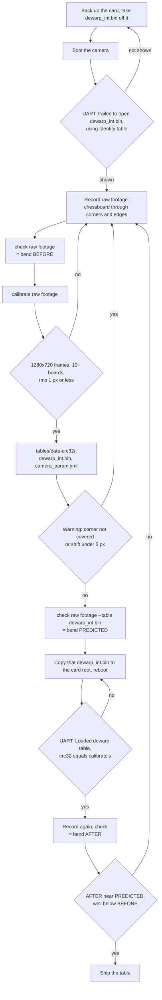

# Build
This build is for the C++ tools (`thermal_homography`, and the older `undistort_table`). The dewarp table needs no build, see [Dewarp table](#dewarp-table).

First, you have to build opencv 4.11.0 on your host. Follow the official instruction:
https://docs.opencv.org/4.x/d7/d9f/tutorial_linux_install.html

You can disable some unnecessary options for speedup:
```
# Download and unpack sources

wget -O opencv.zip https://github.com/opencv/opencv/archive/4.x.zip
wget -O opencv_contrib.zip https://github.com/opencv/opencv_contrib/archive/4.x.zip
unzip opencv.zip
unzip opencv_contrib.zip

# Build target

mkdir build
cd build
cmake -D OPENCV_EXTRA_MODULES_PATH=../opencv_contrib-4.11.0/modules ../opencv-4.11.0 \
      -D ENABLE_SSE3=OFF \
      -D OPENCV_GENERATE_PKGCONFIG=ON \
      -D WITH_TBB=OFF \
      -D WITH_V4L=ON \
      -D WITH_QT=OFF \
      -D WITH_GTK=ON \
      -D BUILD_opencv_python3=ON \
      -D BUILD_opencv_highgui=ON \
      -D WITH_OPENCL=OFF \
      -D BUILD_EXAMPLES=ON ..

cmake --build . -- -j 16
sudo make install
sudo ldconfig
```

Second, build our application

```
mkdir build
cd build
cmake ..
cd ..
make
```

# thermal_homography

### Purpose
Find a homography from thermal image to the camera.

### How to use it

#### 1. Setup thermal features
Connect 16 thermal feature points and make sure those features can be captured by both thermal camera and cmos camera.


#### 2. Record thermal data
This method is dumb because there is no proper method to record thermal data so far.

 - Modify ```set_HTPA_debug_log(2);``` in ```sensorProject\HTPA\src\main.c``` for recording data.
 - Run HTPA project and record its console log.
 - Remove non integer log. Remove ~ 10 lines of log at the beginning. Search ```vdd``` and remove it.
   
#### 3. Record video on camera
I use gstreamer to record the RTSP stream.

 - Run tutk project
 - Run Gstreamer RTSP client to store the video. Please replace url and location.
 ```
 gst-launch-1.0 rtspsrc location=rtsp://192.168.0.31:8080 ! `
	application/x-rtp, media=video, encoding-name=H264  ! `
	queue ! rtph264depay ! h264parse ! tee name=t `
	t. ! queue ! matroskamux ! filesink location=received_h264.mkv `
	t. ! queue ! avdec_h264 ! autovideosink sync=false
 ```

#### 4. Execute thermal_homography
```
cd build
./thermal_homography [thermal_file] [video_file]
```
 - Input the number of feature points you have, 16 in our case.
 - For thermal data, press ```n``` for next frame, press ```space``` for clicking, press ```esc``` when you finished.
 - For video data, press ```n``` for next frame, press ```space``` for clicking, press ```esc``` when you finished.
 - The homography information is showed on the console.

# Dewarp table
`dewarp_table.py` turns chessboard footage into the `dewarp_int.bin` the firmware loads, with no window and no key presses. It needs Python 3 with `opencv-python` and `numpy` from pip; no OpenCV build.

The table is one little-endian 32-bit entry per output pixel of the stream: source row in bits 31..16, source column in bits 15..0, rounded to the nearest pixel and clamped into the frame. The firmware reads it with nearest-neighbour remapping, so no fractional table is written.

## Flow



## Steps

### 1. Clear the card
The RTSP stream is already remapped by the IPU when the card holds `dewarp_int.bin`, and footage taken through a table calibrates to a table that barely moves any pixel. Back up the card, take `dewarp_int.bin` off its root and boot. Go on only when the UART shows `Failed to open dewarp_int.bin, using Identity table`.

### 2. Record
Record the stream with `start_gstreamer.sh`, or pass the `rtsp://` URL straight to the script in the next steps. The camera's RTSP server refuses TCP interleaved transport (SETUP answers 461 Unsupported Transport), so keep the default UDP transport of gstreamer and OpenCV and do not force `rtsp_transport` to tcp. Move a chessboard with 6x9 inner corners (7x10 squares) across the whole frame, corners and edges included, tilting it on the way. About 30 seconds is enough.

### 3. Measure before
`python3 dewarp_table.py check <footage>` prints how far the board's rows and columns bend from straight lines, as the median and the largest value over the frames, in pixels. Note it as BEFORE.

### 4. Calibrate
`python3 dewarp_table.py calibrate <footage>` takes the footage as a video file, an `rtsp://` URL or an image directory. It looks for the board in every 10th frame and stops after 40 boards, at the end of the input or on Ctrl-C; a live stream that drops counts as the end. It writes `dewarp_int.bin` and `camera_param.yml` into a new version directory, `tables/<date>-<crc32>/` (see [Versions](#versions)), and prints the table's path, size, CRC32 and largest pixel shift.

It fails and writes nothing when:
- a frame is not 1280x720, the stream size the firmware expects;
- the board is found in fewer than 10 frames;
- the reprojection error is above 1 px.

It warns, and you should record again, when:
- no board reached one of the frame corners, because the table is extrapolated there;
- no pixel moves by 5 px or more, which usually means the card still held a table during recording.

### 5. Predict
`python3 dewarp_table.py check <footage> --table tables/<date>-<crc32>/dewarp_int.bin` remaps each frame with the table the way the firmware does (nearest neighbour) before measuring. Note it as PREDICTED; it should be well below BEFORE.

### 6. Load on the device
Copy the version's `dewarp_int.bin` to the card root, keeping that file name, and reboot. The UART must show `Loaded dewarp table: 3686400 bytes from dewarp_int.bin, crc32 <value>` with the CRC32 that `calibrate` printed. Any other line means the firmware fell back to the identity table and logged why.

### 7. Measure after
Record again with the table loaded and run `check` on that footage. AFTER should be close to PREDICTED. The table is then ready to ship.

### Options
`--board`, `--size`, `--step` and `--max-views` apply to both subcommands and go before the subcommand. `--min-views`, `--max-rms` and `-o` (the parent of the version directories) belong to `calibrate`, and `--table` to `check`. Keep `--size` at the stream size: the firmware rejects a table of any other size.

### Versions
Every `calibrate` run that succeeds adds a directory under `tables/` named after the date and the table's CRC32, holding the table and the `camera_param.yml` it came from. The YAML also records the CRC32 and the footage it was calibrated from. Old versions stay where they are, so going back to one means copying its `dewarp_int.bin` to the card again.

The firmware only opens `dewarp_int.bin` in the card root and has no version field. A version is identified by the CRC32 the UART prints on load, which is the CRC32 in the directory name. Commit the versions you keep: `tables/**/*.bin` is stored with git LFS.

## Tests
`python3 -m unittest discover tests` renders a chessboard through a known lens, calibrates it and compares the table with the one the known lens gives. It also checks the bit layout, rounding and clamping.

## Earlier tool
`src/undistort_table.cpp` is the earlier interactive tool. It needs camera parameters from `opencv_interactive-calibration` and shows each frame in a window; `dewarp_table.py` replaces it.